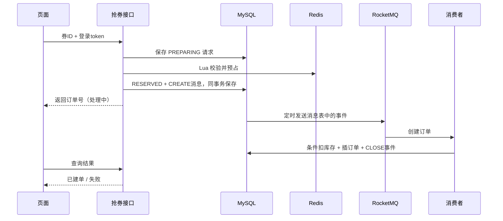

# 邻享生活：设计与学习路线

先看熟悉的 Controller → Service → Mapper，再看新增的缓存、消息与状态机，不用一次读完整个项目。

## 1. 从你已经学过的内容出发

| 已有基础 | 这次增加什么 | 先看哪个文件 |
|---|---|---|
| 商户空值缓存、逻辑过期 | 区分普通商户和指定热点商户；提交后删缓存 | ShopServiceImpl、CacheClient |
| Redis Lua 校验库存 | 记录“哪个订单预占了库存”，重试不重复扣 | seckill.lua、ReservationStore |
| 一人一单、数据库扣库存 | 数据库唯一键与条件更新做最终保护 | linxiang.sql、OrderLifecycle.create |
| 分布式锁 | Redisson 减少多个实例重复扫描；正确性仍靠数据库 | OrderJobs.recover |
| 同步下单 | 请求受理后由 RocketMQ 消费者建单 | CreateOrderConsumer |
| Redis 缓存 | 给热点展示加一层进程内 Caffeine | VoucherDisplayCache |
| Spring AOP | 注解标记需要限制的请求 | RateLimit、RateLimitAspect |
| 订单状态 | 模拟支付、到期关单、幂等回补 | OrderLifecycle.pay / close |

## 2. 抢券分成四步

第一步先保存请求，是为了进程突然退出时还知道“哪个用户在抢哪张券”。第二步用同一个订单号执行 Lua，重复执行也只扣一次。第三步把请求状态和待发送消息放在同一个数据库事务里。第四步消费者自己开启事务，不使用请求线程里的 UserHolder。

这个设计比“Lua 成功后直接 send 一下”多了表和恢复任务，也多了入口数据库开销。它解决的是可恢复性，不是免费提高吞吐。

## 3. 三张核心表

- seckill_request：抢券请求有没有预占、是否已经建单。
- tb_voucher_order：真正的订单，用户与优惠券有联合唯一约束。
- message_outbox：还没发送或补偿完成的事件。发送确认后才标记 SENT。

创建订单：先检查请求，再条件扣 MySQL 库存，再插入订单。插入失败时前面的扣减也回滚。

关闭订单：只有 status=1 且到期的行能改成 4；改成功才增加 MySQL 库存并保存回补事件。重复关单改不到行，就不会再次加库存。

Redis 回补使用 release-reservation.lua，先看预占记录是否已经 RELEASED，所以即使补偿执行两次也只加一次。

## 4. 一人一券的规则

本次活动创建过订单后，取消也不能再次参加；取消释放的名额可以被其他用户抢走。尚未创建订单就失败的预占会释放用户参与记录，允许之后重试。

这是产品规则，不是技术限制。若改成取消后可再次抢购，必须一起改唯一约束、参与记录及订单历史设计。

## 5. 缓存和限流怎么理解

Caffeine 在 Java 进程内，Redis 在独立服务里。展示查询先查近的一层，再查远的一层；库存预占仍直达 Redis Lua。

本地缓存限制条数和 5 秒有效期，Redis 展示缓存有效期 60 秒。更新时删除当前实例本地缓存和 Redis，其他实例的 L1 等待最多 5 秒。但如果旧查询与删除并发，旧值也可能被重新写回 Redis，需要等 Redis 的 60 秒 TTL 及之后可能延续的 L1 窗口；这里没有实现版本栅栏。不能把它描述为强一致。

滑动窗口限流保存最近 10 秒请求。Lua 先删旧记录，再计数、写入新记录；时间取 Redis TIME。同一毫秒的请求使用不同 UUID，避免 ZSet member 重复覆盖。

## 6. 接下来按这个顺序学

1. 跑通页面：看 Network，区分“返回订单号”与“订单已创建”。
2. 阅读 Lua：自己写出重复执行为什么不会再次扣减。
3. 学 Spring 事务：本地事务能管 MySQL，不能同时回滚 Redis。
4. 学 RocketMQ：主题、消费者组、重试、重复消息、延迟级别和死信。
5. 学 outbox：数据库提交成功而 MQ 发送失败时，消息记录怎么继续发送。
6. 学状态机：用两条 SQL 解释支付与关单为什么只有一方成功。
7. 学 JMeter：先定义统计口径，再读吞吐、P95、原始失败率与业务拒绝率。

官方资料：[RocketMQ 4.x 消费与重试](https://rocketmq.apache.org/docs/4.x/consumer/02push/)、[4.x 延迟级别](https://rocketmq.apache.org/zh/docs/4.x/producer/04message3/)、[JMeter 命令行压测](https://jmeter.apache.org/usermanual/get-started.html)。

## 7. 故障怎么处理

- 预占后进程退出：PREPARING 重试同一订单号，Lua 判断已预占后返回成功。
- MQ 短暂不可用：消息表保留 NEW，之后重发；不能直接把库存回补后再让原消息消费。
- 消费者重复收到 CREATE：请求行加锁并检查状态；已成功直接返回。
- CREATE 已发但一直没建单：对长时间 RESERVED 请求重新排入消息表；持续失败应排查日志、重试次数和死信。
- 关单消息晚到：定时扫描到期订单；两条路径调用同一个带状态条件的关单方法。
- Redis 丢失全部数据：停止活动并根据订单/请求对账恢复，不直接把数据库 stock 覆盖到正在使用的 Redis。
